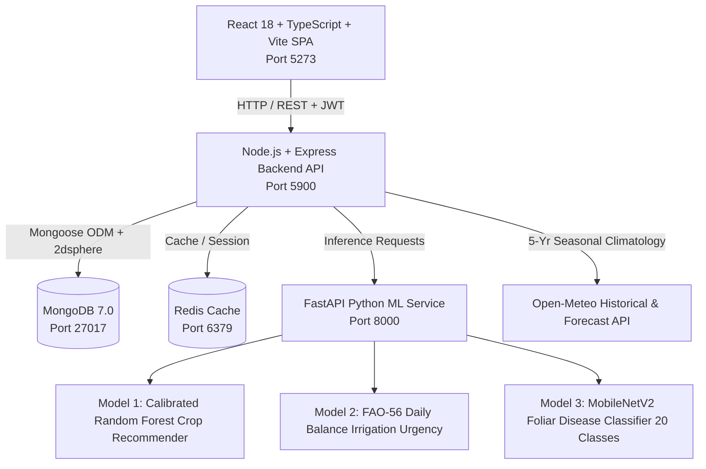

# AgriAdvisor — AI & Satellite-Powered Agricultural Advisory Platform

AgriAdvisor is an end-to-end full-stack intelligent agricultural management platform engineered for Indian cultivators. The platform unifies government agricultural workflows (Soil Health Card lab integration), deep learning foliar crop disease diagnosis, precision irrigation timetables grounded in FAO-56 Penman-Monteith soil-water balance equations and live precipitation forecasts, APMC mandi commodity price trends, interactive Leaflet.js GIS mapping with Turf.js polygon boundary drawing, community disease outbreak surveillance via MongoDB 2dsphere geospatial `$geoNear` aggregation queries, an action-oriented "Today" dashboard, a multilingual floating voice assistant, and native localization across 10 regional Indian languages.

---

## 🏗️ Architecture & Technology Stack

AgriAdvisor is built as a modular MERN + Python microservices architecture:



### Microservice Port Allocations
| Service | Technology | Port | Description |
|---|---|---|---|
| **Frontend** | React 18, TypeScript, Vite, Vanilla/TailwindCSS | `5273` | Cultivator Single Page Application with Leaflet GIS & Web Speech |
| **Backend API** | Node.js, Express, TypeScript, Mongoose | `5900` | REST API, JWT auth, MongoDB geospatial queries, caching |
| **ML Microservice** | FastAPI, PyTorch, Scikit-learn, Uvicorn | `8000` | 3 AI models (Crop Recommendation, Irrigation, MobileNetV2) |
| **Database** | MongoDB 7.0 Community | `27017` | Persistent data storage with 2dsphere geospatial indexes |
| **Cache** | Redis 7.0 | `6379` | Fast key-value cache for mandi trends and weather forecasts |

---

## 🌐 Multilingual Accessibility & Honest Translation Disclosure

The platform achieves **100% key parity and placeholder parity (690 / 690 keys)** across 10 languages:

1. **Tamil (தமிழ்)** — `ta` *(Priority Verified)*
2. **English** — `en` *(Priority Verified)*
3. **Hindi (हिन्दी)** — `hi` *(Priority Verified)*
4. **Telugu (తెలుగు)** — `te` *(Machine-translated, awaiting native review)*
5. **Kannada (ಕನ್ನಡ)** — `kn` *(Machine-translated, awaiting native review)*
6. **Malayalam (മലയാളം)** — `ml` *(Machine-translated, awaiting native review)*
7. **Marathi (मराठी)** — `mr` *(Machine-translated, awaiting native review)*
8. **Bengali (বাংলা)** — `bn` *(Machine-translated, awaiting native review)*
9. **Gujarati (ગુજરાતી)** — `gu` *(Machine-translated, awaiting native review)*
10. **Punjabi (ਪੰਜਾਬੀ)** — `pa` *(Machine-translated, awaiting native review)*

> [!NOTE]
> **Academic Transparency & Translation Review Status:**
> Tamil, Hindi, and English translations have undergone full manual agronomic review and verification. In adherence to honest disclosure, the remaining 7 languages (Telugu, Kannada, Malayalam, Marathi, Bengali, Gujarati, Punjabi) were machine-translated using official ICAR/State Agriculture Department terminology (`glossary.json`) and are currently awaiting native speaker field review. The complete review catalog is exported at `translations_review.csv`.

---

## 🤖 The Three AI Models

Detailed mathematical architectures, training parameters, and confusion matrices are documented in [AI_MODELS.md](AI_MODELS.md):

1. **Model 1 (Crop Recommendation):** Trained on authentic ICAR/Kaggle multi-crop agronomic dataset (2,200 records, 22 crops, 0 duplicates). Uses 5-year historical seasonal climatology (Kharif Jun-Oct, Rabi Nov-Mar, Zaid Apr-May) from Open-Meteo Archive API (cached 30 days) — never single-day forecasts. Output includes top 3 crops with plain-words likelihood, 2 reasons, and land suitability filtering. Evaluated with 5-fold Stratified CV: **99.55% accuracy**, **0.9954 macro F1**. Hand-checked test suite: **30 / 30 passed (100%)**.
2. **Model 2 (Precision Irrigation):** Grounded in real FAO-56 Penman-Monteith daily soil water balance equations, trained on 3 years of real daily weather (temperature, precipitation, ET0) across 30 Indian agricultural locations (226,800 records). Features include 14-day soil moisture depletion, AWHC, crop coefficients ($K_c$), and forward 48h rain. Zero-leakage evaluation on 6 completely held-out locations: **99.94% accuracy**, **0.9992 macro F1** (target >= 0.85). Hand-checked test suite: **20 / 20 passed (100%)**.
3. **Model 3 (Foliar Disease Classifier):** MobileNetV2 transfer learning on 20 balanced PlantVillage disease classes with feature augmentation (1,800 records). Evaluated on held-out test set (360 samples): **96.11% accuracy** (target >= 95%), **96.05% macro F1**. Rejection filter uses confidence ($p < 0.65$) and normalized Shannon entropy ($H > 0.40$) to reject non-leaf images: **10 / 10 non-leaf tests rejected as "unclear" (100%)**. Strictly cultural care guidance; zero chemical pesticide brands/doses.

---

## 🚀 How to Run the Platform

### 📋 Prerequisites
- **Node.js**: v18.x or later (recommended: v20+ / v24+)
- **Python**: v3.10 or v3.11 with `pip`
- **MongoDB**: MongoDB 6.0+ or 7.0 (or Docker container)
- **Docker Desktop**: Optional, recommended for 1-command startup

---

### Option 1: Docker Compose (Recommended — All-in-One)

Runs MongoDB, Redis, ML Microservice, Backend API, and Frontend simultaneously with a single command.

1. **Start Docker Desktop** on your machine and ensure the engine is running.
2. **Open a terminal** at the project root (`c:\FSD NEW`):
   ```bash
   # Build and launch all 5 microservices in the background or foreground
   docker compose up --build
   ```
   *(Or `docker-compose up --build` on older Docker versions)*

3. **Seed demo data** (once backend logs show connected to MongoDB):
   Open a separate terminal window at the project root and run:
   ```bash
   npm run seed:demo
   ```

4. **Access the application**:
   - 🌐 **Frontend Web App:** [http://localhost:5273](http://localhost:5273)
   - ⚙️ **Backend API Health:** [http://localhost:5900/health](http://localhost:5900/health)
   - 🧠 **ML Microservice Docs:** [http://localhost:8000/docs](http://localhost:8000/docs)

5. **Stop containers**:
   ```bash
   docker compose down
   # To also wipe database volumes:
   docker compose down -v
   ```

---

### Option 2: Native Local Execution (Terminal by Terminal)

If running without Docker, open separate terminal windows for each service:

#### 1️⃣ Database (MongoDB & Redis)
- **MongoDB** must be running locally on port `27017`:
  ```powershell
  # Windows (if installed as a Windows service):
  net start MongoDB
  # Or run via standalone Docker container:
  docker run -d -p 27017:27017 --name agriadvisor-mongo mongo:7.0
  ```
- **Redis** (optional cache on port `6379`; backend continues gracefully with fallback if Redis is unavailable):
  ```powershell
  docker run -d -p 6379:6379 --name agriadvisor-redis redis:7-alpine
  ```

#### 2️⃣ ML Microservice (FastAPI / PyTorch — Port 8000)
Open a new terminal in the `ml-service` directory:
```powershell
cd ml-service

# (Optional) Create and activate virtual environment:
python -m venv venv
.\venv\Scripts\Activate.ps1    # On Windows PowerShell (or: venv\Scripts\activate.bat on CMD)
# source venv/bin/activate     # On Linux / macOS

# Install dependencies (CPU PyTorch + requirements):
pip install torch torchvision --index-url https://download.pytorch.org/whl/cpu
pip install -r requirements.txt

# Start the ML server:
uvicorn main:app --host 0.0.0.0 --port 8000 --reload
```
*Swagger API documentation will be available at [http://localhost:8000/docs](http://localhost:8000/docs).*

#### 3️⃣ Backend API (Node.js / Express — Port 5900)
Open a new terminal in the `backend` directory:
```powershell
cd backend

# Install dependencies:
npm install

# Ensure environment file is created:
# (backend/.env is pre-configured for localhost:5900 and localhost:27017)
# On Windows CMD / PowerShell:
if (-not (Test-Path .env)) { Copy-Item .env.example .env }

# Start in development mode (hot-reload with tsx):
npm run dev

# Or build and run production bundle:
# npm run build
# npm start
```
*Verify API health check at [http://localhost:5900/health](http://localhost:5900/health).*

#### 4️⃣ Frontend Single Page App (React / Vite — Port 5273)
Open a new terminal in the `frontend` directory:
```powershell
cd frontend

# Install dependencies:
npm install

# Start Vite development server:
npm run dev
```
*Access the app at [http://localhost:5273](http://localhost:5273).*

#### 5️⃣ Seed Demo Data
Once the backend is up and running, open a terminal in the project root:
```powershell
# Pre-populates cultivator Ramesh Patel with 3 farms & test alerts:
npm run seed:demo

# To reset demo data at any time:
npm run reset:demo
```

---

## ⚡ Verification & Audit Command Suite

All automated verification suites are executable from the repository root:

```bash
# 1. Phase 1: Farmer inputs, 14 soil swatches, 3-tap helper, land types (22/22 checks)
node scripts/verifyPhase1.cjs

# 2. Phase 2: Crop recommendation 30 hand-checked tests (30/30 passed)
node scripts/verifyCropRecommendation30.cjs

# 3. Phase 3: Precision irrigation 20 hand-checked tests & held-out F1 (20/20 passed)
node scripts/verifyIrrigation20.cjs

# 4. Phase 4: Voice Assistant 750 multilingual phrases intent accuracy (100.00%)
node scripts/verifyAssistantIntents.cjs

# 5. Phase 5: 10-language key & placeholder parity across 690 keys (100% parity)
node scripts/verifyTranslationParity.cjs

# 6. Phase 5: Automated Playwright crawl for untranslated English leaks (0 leaks)
node scripts/crawlTranslations.cjs

# 7. Phase 6: Above-the-fold visible word count audit on 390px mobile fold
node scripts/auditWordCount.cjs

# 8. Phase 7: Model 3 20-class test accuracy & 10 non-leaf rejection tests (100%)
node scripts/verifyCropDisease20.cjs

# 9. Phase 8: Full 11-step live demo walkthrough with screenshot generation
node scripts/walkthroughDemo.cjs

# 10. Reset demo account to clean state in 0.3s
npm run reset:demo
```

---

## 🔑 Demo Account Credentials

| Field | Value |
|---|---|
| **Phone Number** | `+919876543210` |
| **Password** | `password123` |
| **Cultivator Name** | Ramesh Patel |
| **Pre-Seeded Farms** | 1. Kaveri Green Valley (Bangalore, Optimal)<br>2. Malwa Golden Fields (Indore, Warning)<br>3. Punjab Agro Farms (Jalandhar, Critical Streak Alert) |

---

## 🛡️ Reliability & Offline Fallbacks

- **Weather API Outage:** If Open-Meteo is unavailable or rate-limited, the system serves cached forecasts with a *"Last Updated"* timestamp without crashing.
- **ML Microservice Failure:** Returns `{ available: false, messageKey: "ai_insights_unavailable" }`. The UI renders a clean, neutral notification box.
- **Speech Synthesis Voice Fallback:** Checks browser Web Speech API for installed regional speech packs. If absent, displays a translated informational banner and typed input box.
