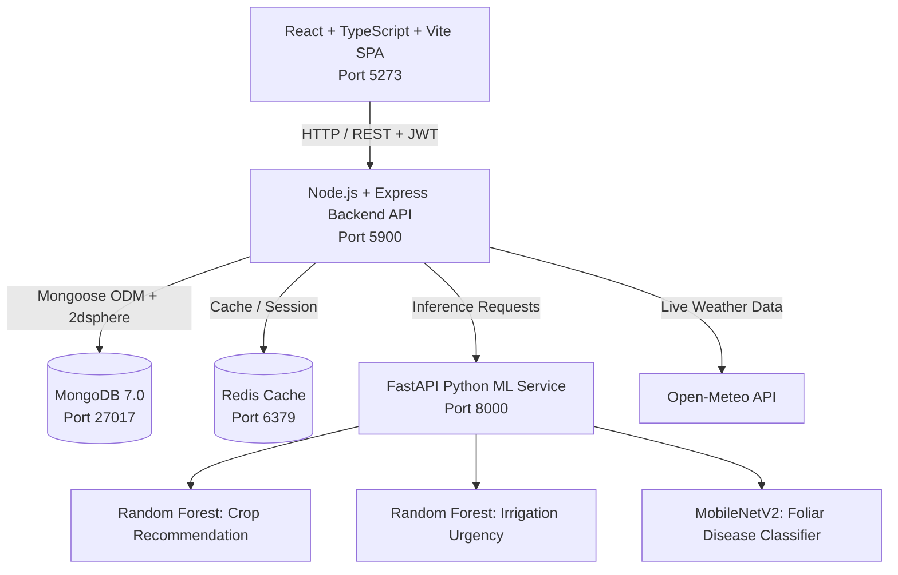

# AgriAdvisor — AI & Satellite-Powered Agricultural Advisory Platform

AgriAdvisor is an end-to-end full-stack intelligent agricultural management platform built for Indian cultivators. The platform unifies government agricultural workflows (Soil Health Card integration), deep learning foliar crop disease diagnosis, precision irrigation timetables based on soil percolation and 24-hour precipitation forecasts, APMC mandi commodity price trends, interactive Leaflet.js GIS mapping with boundary drawing, community disease outbreak surveillance via MongoDB 2dsphere geospatial `$geoNear` queries, and native accessibility across 10 Indian regional languages.

---

## 🏗️ Architecture & Technology Stack

AgriAdvisor is built as a modular microservices architecture:



### Microservice Port Allocations
| Service | Technology | Port | Description |
|---|---|---|---|
| **Frontend** | React 18, TypeScript, Vite, TailwindCSS | `5273` | Cultivator Single Page Application with Leaflet GIS & Web Speech |
| **Backend API** | Node.js, Express, TypeScript, Zod | `5900` | REST API, JWT auth, MongoDB geospatial queries, caching |
| **ML Microservice** | FastAPI, PyTorch, Scikit-learn, Uvicorn | `8000` | 3 AI models (Crop Recommendation, Irrigation, MobileNetV2) |
| **Database** | MongoDB 7.0 Community | `27017` | Persistent data storage with 2dsphere geospatial indexes |
| **Cache** | Redis 7.0 | `6379` | Fast key-value cache for mandi trends and weather forecasts |

---

## 🌐 Multilingual Accessibility (10 Indian Regional Languages)

The platform is configured with `i18next` with **zero hardcoded strings** across all public and authenticated screens, achieving **100% key parity (470 / 470 keys)** across all 10 languages:

1. **Tamil (தமிழ்)** — `ta`
2. **English** — `en`
3. **Hindi (हिन्दी)** — `hi`
4. **Telugu (తెలుగు)** — `te`
5. **Kannada (ಕನ್ನಡ)** — `kn`
6. **Malayalam (മലയാളം)** — `ml`
7. **Marathi (मराठी)** — `mr`
8. **Bengali (বাংলা)** — `bn`
9. **Gujarati (ગુજરાતી)** — `gu`
10. **Punjabi (ਪੰਜਾਬੀ)** — `pa`

*Run `npm run check-i18n` to verify zero missing keys across all catalogs.*

---

## 🚀 How to Run the Platform

### Option 1: Docker Compose (All Services Containerized)

Ensure Docker Desktop is running on your machine:
```bash
# 1. Clean build and start all 5 containers
docker-compose up --build

# 2. Seed the live demo scenario
npm run seed:demo

# 3. Open in browser:
# Frontend:  http://localhost:5273
# API Health: http://localhost:5900/health
# ML Health:  http://localhost:8000/docs
```

To stop containers:
```bash
docker-compose down -v
```

---

### Option 2: Run Services Locally (Development Mode)

#### 1. Start MongoDB & Redis
Ensure MongoDB is running locally on port `27017` and Redis on port `6379`.

#### 2. Start ML Microservice (FastAPI / PyTorch)
```bash
cd ml-service
python -m venv venv
venv\Scripts\activate   # On Windows (or source venv/bin/activate on Linux/Mac)
pip install -r requirements.txt
python -m uvicorn main:app --port 8000
```

#### 3. Start Backend API (Node.js / Express)
```bash
cd backend
npm install
npm run build
npm start              # Runs on port 5900
```

#### 4. Start Frontend (React / Vite)
```bash
cd frontend
npm install
npm run dev            # Runs on port 5273
```

---

## ⚡ Demo & Verification Commands

All core demo scripts are available from the root repository:

```bash
# 1. Seed the 3-farm demo scenario (Bangalore, Indore, Jalandhar + health logs + 6 demo disease alerts)
npm run seed:demo

# 2. Reset the demo state to pristine in under 1 second (< 1 minute requirement)
npm run reset:demo

# 3. Verify complete 10-language parity (470/470 keys)
npm run check-i18n

# 4. Run Crop Lifecycle & Sowing Window test suite
node scripts/verifyCropLifecycle.cjs

# 5. Run Quality Pass (Desktop & 390px Mobile Viewport audit)
node scripts/verifyQualityPass.cjs

# 6. Run Community Disease Alerts Geospatial verification ($geoNear)
node scripts/verifyCommunityOutbreaks.cjs

# 7. Run Extended Farm Map test suite (Street/Satellite, Boundaries, Mandis)
node scripts/verifyFarmMapExtension.cjs

# 8. Run 12-Item Formal Verification Suite
node scripts/verify12Checks.cjs
```

---

## 🔑 Demo Account Credentials

| Field | Value |
|---|---|
| **Phone Number** | `+919876543210` |
| **Password** | `password123` |
| **Farmer Name** | Ramesh Patel |
| **Pre-Seeded Farms** | 1. Kaveri Green Valley (Bangalore, Optimal)<br>2. Malwa Golden Fields (Indore, Warning)<br>3. Punjab Agro Farms (Jalandhar, Critical Streak Alert) |

---

## 🛡️ Reliability & Offline Fallbacks

- **Weather API Failure:** If the Open-Meteo external service is unavailable or rate-limited, the system seamlessly serves the last cached forecast from MongoDB/Redis with a visible *"Last Updated"* timestamp. Screens never crash or render blank.
- **ML Microservice Failure:** If the Python ML microservice is stopped or unreachable, the backend catches the error and returns `{ available: false, messageKey: "ai_insights_unavailable" }`. The frontend renders a neutral, polite notification box while all other pages continue working smoothly.
- **Speech Synthesis Voice Fallback:** The "Listen" TTS feature checks if the user's host OS has a matching voice for the active language. If unavailable, it disables the button and displays a translated notice without crashing.
